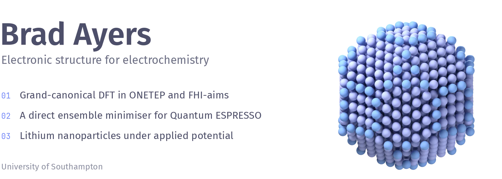
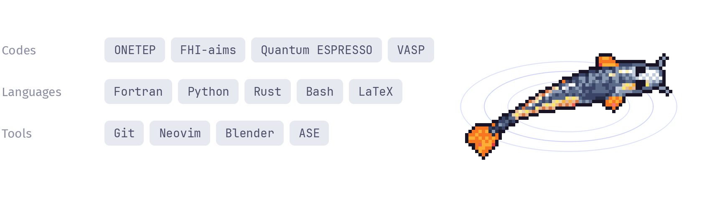

<picture><source media="(prefers-color-scheme: dark)" srcset="assets/header-mocha.webp"></picture>

<picture><source media="(prefers-color-scheme: dark)" srcset="koi/koi-mocha.webp"></picture>

<a href="mailto:ba3g18@soton.ac.uk"><picture><source media="(prefers-color-scheme: dark)" srcset="assets/icon-email-mocha.png"></picture></a>&nbsp;&nbsp;&nbsp;&nbsp;
<a href="https://orcid.org/0000-0002-7439-6568"><picture><source media="(prefers-color-scheme: dark)" srcset="assets/icon-orcid-mocha.png"></picture></a>&nbsp;&nbsp;&nbsp;&nbsp;
<a href="https://doi.org/10.1039/D5TA09820C"><picture><source media="(prefers-color-scheme: dark)" srcset="assets/icon-paper-mocha.png"></picture></a>&nbsp;&nbsp;&nbsp;&nbsp;
<a href="https://github.com/yalongwastaken/git-koi"><picture><source media="(prefers-color-scheme: dark)" srcset="assets/icon-koi-mocha.png"></picture></a>

